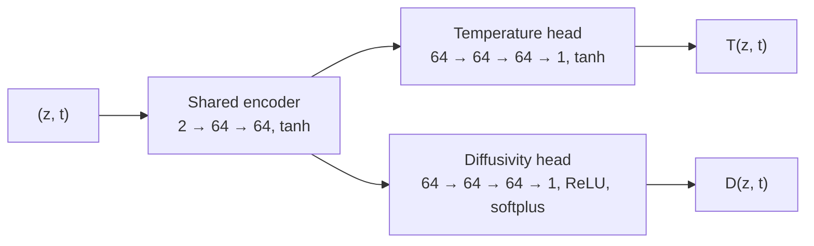

# Ocean Heat Diffusion PINN

[](https://github.com/sahridkancherla/Ocean-Diffusion-PINN/actions/workflows/tests.yml)
[](https://www.python.org/)
[](https://pytorch.org/)
[](LICENSE)

A physics-informed neural network (PINN) that learns the temperature of the upper
North Pacific from mooring observations and infers the vertical heat diffusivity
that governs it. The network is fitted to five years of 10-minute temperature
records from the NOAA [Kuroshio Extension Observatory (KEO)](https://www.pmel.noaa.gov/ocs/KEO)
mooring while being constrained to satisfy the one-dimensional heat diffusion equation.

## Method

Temperature $T(z, t)$ in the water column is modelled as vertical diffusion with an
unknown diffusivity $D(z, t)$ that varies with depth and time:

$$
\frac{\partial T}{\partial t} = \frac{\partial}{\partial z}\left( D(z, t)\, \frac{\partial T}{\partial z} \right)
$$

A single network maps depth and time to both fields. $T$ is fitted to the
observations, while $D$ is never observed and is learned only through the PDE. A
final softplus keeps $D$ positive.



The derivatives in the PDE come from automatic differentiation, and the network is
trained with Adam on a weighted sum of four losses:

| Term | Penalises | Evaluated at | Weight |
|---|---|---|---|
| Data | $(T - T_{\mathrm{obs}})^2$ | observations | 10 |
| Physics | $\left(\partial_t T - \partial_z (D \, \partial_z T)\right)^2$ | random collocation points | 0.1 |
| Deep boundary | $(T - T_{\mathrm{obs}})^2$ at the deepest sensor | observation times | 0.1 |
| Surface boundary | $(T - T_{\mathrm{obs}})^2$ at the 1 m sensor | observation times | 0.1 |

Both boundaries use measured temperatures, so no temperature or flux is assumed at either
end. They overlap with the data term and mostly serve to anchor the ends of the column.

Everything is in normalised units: $z$ and $t$ are min–max scaled to $[0, 1]$ and
temperature is standardised with the statistics of the training period. Because $z$ is
height (negative below the sea surface), $z = 0$ is about 530 m and $z = 1$ is 1 m. The
learned diffusivity and velocity convert to physical units as

$$
D_{\mathrm{phys}} = D \, \frac{(z_{\max} - z_{\min})^2}{t_{\max} - t_{\min}} \approx 1.6 \times 10^{-3} \, D \ \ \mathrm{m^2\,s^{-1}},
\qquad
w_{\mathrm{phys}} = w \, \frac{z_{\max} - z_{\min}}{t_{\max} - t_{\min}} \approx 3.1 \times 10^{-6} \, w \ \ \mathrm{m\,s^{-1}}.
$$

### Advection-diffusion model

`scripts/train.py --advection` fits a second model that adds a vertical velocity:

$$
\frac{\partial T}{\partial t} + w(z, t)\frac{\partial T}{\partial z} = \frac{\partial}{\partial z}\left( D(z)\, \frac{\partial T}{\partial z} \right)
$$

If $D$ and $w$ could both vary freely in depth and time, almost any $D$ could be balanced
by some $w$. So here $D$ is positive and constant in time, and the loss also penalises
$w^2$ (weight $10^{-3}$) and $(\partial_z w)^2$ (weight $10^{-4}$). A single mooring cannot
observe horizontal advection, so $w$ will absorb some of it, and neither model's
coefficients should be read as direct measurements of mixing or vertical motion.

## Data

Temperature and pressure recorded every 10 minutes at 21 nominal depths between
1 m and 525 m, from 1 January 2015 to 19 May 2020, at the KEO mooring
(32.3° N, 144.6° E) of the NOAA PMEL [Ocean Climate Stations](https://www.pmel.noaa.gov/ocs/)
project. Two levels whose records begin with a gap are dropped, missing samples are
forward-filled, and because the mooring line moves, sensor depths are computed from
the measured pressure with [TEOS-10](https://www.teos-10.org/). See
[`data/README.md`](data/README.md) for the files and preprocessing.

The resulting 19 × 282,979 ≈ 5.4 million observations are split in time. The first 80% of
the record (4,301,277 points) is used for training and the last 20%, from 22 April 2019
(1,075,324 points), for testing, so every depth appears in both.

## Do the data obey these equations?

`scripts/check_pde.py` answers this from the measurements alone, with no network. It
estimates temperature tendencies and gradients by finite differences from measured samples
only (forward-filled values are ignored), removes the apparent change caused by sensors
moving through the water, fits smooth profiles of $D$ and $w$ to the first 80% of the record,
and scores them on the last 20%. The score is the share of the tendency explained: 1 is
a perfect budget and 0 is no better than predicting no change. Depth-coherent changes can
come from vertical or horizontal motion, so a physics-free average of the neighbouring
sensors is included as a reference. See
[`src/ocean_pinn/pde_check.py`](src/ocean_pinn/pde_check.py) for the method.

| Share of tendency explained | 1-day averages | 7-day averages | 30-day averages |
|---|---|---|---|
| Diffusion, $D(z)$ | 0.00 | 0.01 | 0.01 |
| Advection-diffusion, steady $w(z)$ | 0.02 | 0.09 | 0.16 |
| Advection-diffusion, moving $w(z, t)$ | 0.49 | 0.64 | 0.50 |
| Average of neighbouring sensors, no physics | 0.70 | 0.89 | 0.89 |

Vertical diffusion alone explains almost none of the observed temperature change. A moving
$w$ explains much more, but overall less than the physics-free reference. It beats the
reference only in the thermocline, from about 220 m down on 7-day and most 30-day averages.

## Project structure

```
├── checkpoints/           saved model weights
├── data/                  KEO mooring record (see data/README.md)
├── scripts/
│   ├── train.py           train the PINN
│   ├── evaluate.py        loss terms and temperature RMSE on a data split
│   ├── plot_results.py    observed vs predicted temperature
│   └── check_pde.py       how well the data obey each PDE, with no network
├── src/ocean_pinn/
│   ├── config.py          default data settings and hyperparameters
│   ├── data.py            loading, cleaning and normalising the record
│   ├── model.py           the diffusion and advection-diffusion networks
│   ├── losses.py          data, boundary and PDE residual losses
│   ├── training.py        training loop and checkpointing
│   ├── evaluation.py      evaluation and inference
│   ├── pde_check.py       finite-difference heat budget of the observations
│   ├── plotting.py        figures
│   └── utils.py           device and mini-batch helpers
└── tests/                 unit tests
```

## Getting started

```bash
git clone https://github.com/sahridkancherla/Ocean-Diffusion-PINN.git
cd Ocean-Diffusion-PINN
python -m venv .venv
source .venv/bin/activate    # Windows: .venv\Scripts\activate
pip install -e .
```

To train on a GPU, first install the CUDA build of PyTorch by following the
[PyTorch instructions](https://pytorch.org/get-started/locally/).

## Usage

Run the scripts from the repository root:

```bash
python scripts/train.py          # writes checkpoints/checkpoint.pt
python scripts/evaluate.py       # loss terms and temperature RMSE on the test split
python scripts/plot_results.py   # writes figures/temperature_comparison.png
python scripts/check_pde.py      # how well the data obey each PDE, with no network

# The advection-diffusion model
python scripts/train.py --advection --checkpoint checkpoints/advection_diffusion.pt
python scripts/evaluate.py --checkpoint checkpoints/advection_diffusion.pt
```

The temperature record is extracted from `data/temp.cdf.zip` on first use. Training
uses the GPU when one is available; an epoch takes a minute or two on a CPU. Every
script accepts `--help`; for example, `python scripts/train.py --epochs 20 --lr 1e-4`.
The defaults are defined in [`src/ocean_pinn/config.py`](src/ocean_pinn/config.py).

## Tests

```bash
pip install -e ".[dev]"
pytest
```

The tests use small synthetic datasets, and check the PDE residual against analytic
solutions of the diffusion equation.

## Acknowledgements

Data provided by the Ocean Climate Stations (OCS) Project Office of NOAA/PMEL.

## License

[MIT](LICENSE)
