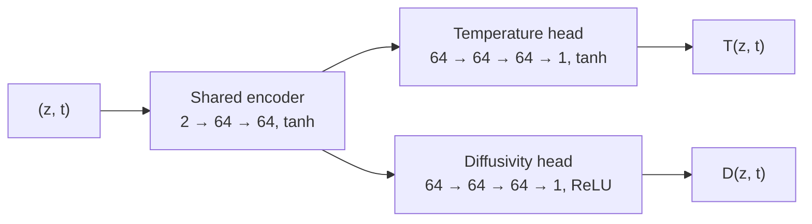

# Ocean Heat Diffusion PINN

[](https://github.com/sahridkancherla/Ocean-Diffusion-PINN/actions/workflows/tests.yml)
[](https://www.python.org/)
[](https://pytorch.org/)
[](LICENSE)

A physics-informed neural network (PINN) that learns the temperature of the upper
North Pacific from mooring observations and infers the vertical heat diffusivity
that governs it. The network is fitted to five years of 10-minute temperature
records from the NOAA [Kuroshio Extension Observatory (KEO)](https://www.pmel.noaa.gov/ocs/KEO)
mooring while being constrained to satisfy the one-dimensional heat diffusion equation.

## Method

Temperature $T(z, t)$ in the water column is modelled as vertical diffusion with an
unknown diffusivity $D(z, t)$ that varies with depth and time:

$$
\frac{\partial T}{\partial t} = \frac{\partial}{\partial z}\left( D(z, t)\, \frac{\partial T}{\partial z} \right)
$$

A single network maps depth and time to both fields. $T$ is fitted to the
observations, while $D$ is never observed and is learned only through the PDE.



The derivatives in the PDE come from automatic differentiation, and the network is
trained with Adam on a weighted sum of four losses:

| Term | Penalises | Evaluated at | Weight |
|---|---|---|---|
| Data | $(T - T_{\mathrm{obs}})^2$ | observations | 10 |
| Physics | $\left(\partial_t T - \partial_z (D \, \partial_z T)\right)^2$ | random collocation points | 0.1 |
| Boundary at $z = 0$ | $T^2$ (Dirichlet) | observation times | 0.1 |
| Boundary at $z = 1$ | $(\partial_z T)^2$ (Neumann) | observation times | 0.1 |

Everything is in normalised units: $z$ and $t$ are min–max scaled to $[0, 1]$ and
temperature is standardised. Because $z$ is height (negative below the sea surface),
$z = 0$ is the deepest sensor (about 530 m) and $z = 1$ the shallowest (1 m). The
learned diffusivity converts to physical units as

$$
D_{\mathrm{phys}} = D \, \frac{(z_{\max} - z_{\min})^2}{t_{\max} - t_{\min}} \approx 1.6 \times 10^{-3} \, D \ \ \mathrm{m^2\,s^{-1}}.
$$

## Data

Temperature and pressure recorded every 10 minutes at 21 nominal depths between
1 m and 525 m, from 1 January 2015 to 19 May 2020, at the KEO mooring
(32.3° N, 144.6° E) of the NOAA PMEL [Ocean Climate Stations](https://www.pmel.noaa.gov/ocs/)
project. Two levels whose records begin with a gap are dropped, missing samples are
forward-filled, and because the mooring line moves, sensor depths are computed from
the measured pressure with [TEOS-10](https://www.teos-10.org/). See
[`data/README.md`](data/README.md) for the files and preprocessing.

The resulting 19 × 282,979 ≈ 5.4 million observations are ordered level by level from
the surface down. The first 2,998,271 (the sensors from 1 m to 100 m, plus 125 m until
March 2018) are used for training and the remaining 2,378,330 (the deeper sensors)
for testing.

## Project structure

```
├── checkpoints/           saved model weights
├── data/                  KEO mooring record (see data/README.md)
├── scripts/
│   ├── train.py           train the PINN
│   ├── evaluate.py        loss terms and temperature RMSE on a data split
│   └── plot_results.py    observed vs predicted temperature
├── src/ocean_pinn/
│   ├── config.py          default data settings and hyperparameters
│   ├── data.py            loading, cleaning and normalising the record
│   ├── model.py           the two-headed network
│   ├── losses.py          data, boundary and PDE residual losses
│   ├── training.py        training loop and checkpointing
│   ├── evaluation.py      evaluation and inference
│   ├── plotting.py        figures
│   └── utils.py           device and mini-batch helpers
└── tests/                 unit tests
```

## Getting started

```bash
git clone https://github.com/sahridkancherla/Ocean-Diffusion-PINN.git
cd Ocean-Diffusion-PINN
python -m venv .venv
source .venv/bin/activate    # Windows: .venv\Scripts\activate
pip install -e .
```

To train on a GPU, first install the CUDA build of PyTorch by following the
[PyTorch instructions](https://pytorch.org/get-started/locally/).

## Usage

Run the scripts from the repository root:

```bash
python scripts/train.py          # writes checkpoints/checkpoint.pt
python scripts/evaluate.py       # loss terms and temperature RMSE on the test split
python scripts/plot_results.py   # writes figures/temperature_comparison.png
```

The temperature record is extracted from `data/temp.cdf.zip` on first use. Training
uses the GPU when one is available; an epoch takes about a minute on a CPU. Every
script accepts `--help`; for example, `python scripts/train.py --epochs 20 --lr 1e-4`.
The defaults are defined in [`src/ocean_pinn/config.py`](src/ocean_pinn/config.py).

## Tests

```bash
pip install -e ".[dev]"
pytest
```

The tests use small synthetic datasets, and check the PDE residual against analytic
solutions of the diffusion equation.

## Acknowledgements

Data provided by the Ocean Climate Stations (OCS) Project Office of NOAA/PMEL.

## License

[MIT](LICENSE)
